<div align="center">

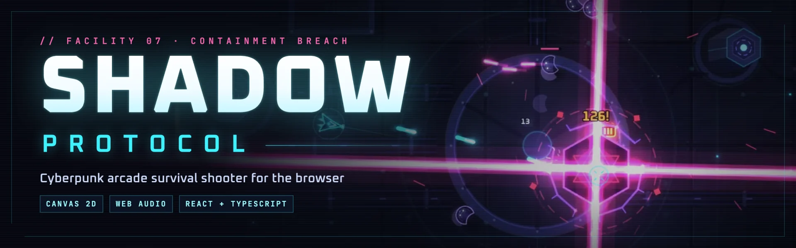

**Ten waves. Two bosses. One way out.**

A cyberpunk arcade survival shooter for the browser. Every pixel is drawn live on an HTML5 canvas and every sound is synthesised at runtime: no image files, no audio files, no server.

[](https://github.com/tanmaytyagii/shadow-protocol/actions/workflows/ci.yml)


[Features](#features) · [Screenshots](#screenshots) · [Quick start](#quick-start) · [Controls](#controls) · [Architecture](#architecture) · [Testing](#testing) · [Contributing](#contributing)

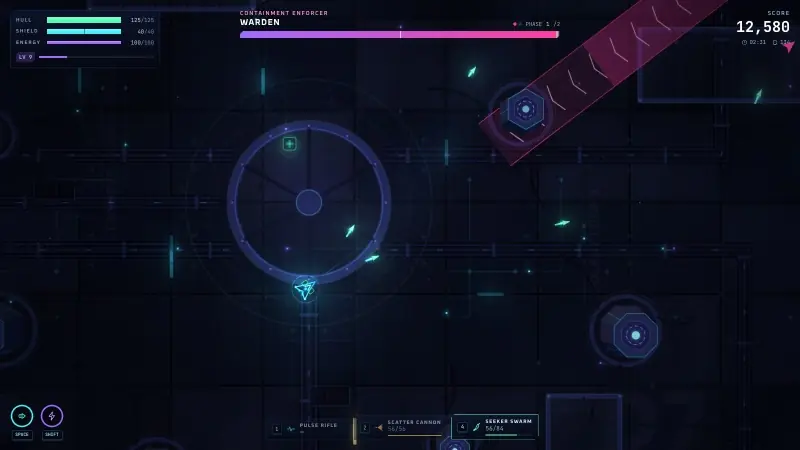

<sub>The Warden fight at wave 5, from an unassisted run, recorded from the production build in Chrome.</sub>

</div>

## About the game

You are a rogue operative trapped on a reactor platform above an abyss. Hostiles pour through spawn portals in ten escalating waves. Between fights you install augments that reshape your build, pick up heavier weapons, and push toward the two bosses: the **Warden** at wave 5 and the **Null Sovereign** at wave 10.

It plays like a twin-stick arena shooter with roguelite progression. Runs take minutes, the game saves a checkpoint at each wave, and new loadouts and a Nightmare difficulty unlock as you go further.

**Why it's different:**

- **Fully procedural.** The arena, effects, lighting and post-processing are drawn with Canvas 2D; the music, ambience and effects are synthesised with the Web Audio API. The only shipped assets are two fonts.
- **Readable chaos.** Every enemy and boss attack is telegraphed, and the telegraphs are drawn from the real collision values. What you see is exactly what hits.
- **Built to run anywhere.** An adaptive quality governor scales decorative effects to hold the frame rate, there's a full touch twin-stick mode, and the interface reflows from a 320 px phone to an ultrawide monitor.

## Features

| Area | What's in the game |
| --- | --- |
| **Combat** | Mouse-aimed shooting, a dash with invulnerability frames that passes through enemies and bullets, an energy-draining boost, hit-stop and screen shake. |
| **Arsenal** | Four weapons: Pulse Rifle (infinite), Scatter Cannon, Rail Lancer (piercing) and Seeker Swarm (homing). |
| **Enemies** | Hunter Drones, Sentinels, Brutes, Wraiths and Splitters, plus tougher elite variants with better loot. |
| **Bosses** | The two-phase **Warden** and the three-phase **Null Sovereign**: bullet novas, gapped rings, sweeping and crossed lasers, mines and teleports, each with its own arrival sequence. |
| **Progression** | XP shards and level-ups with 3-of-21 rarity-weighted augments (crits, piercing, multishot, lifesteal, explosive rounds and more). Timed power-ups, supply drops and a combo multiplier up to ×3. |
| **Persistence** | High scores and records, loadout and difficulty unlocks, and a per-wave checkpoint with **Continue**, all saved in `localStorage`. |
| **Visuals** | A layered parallax arena, dynamic floor lighting, bloom, refraction shockwaves and colour grading that follows combat intensity. Low/Medium/High presets plus automatic scaling. |
| **Audio** | A synthesised soundtrack, reactor ambience and per-attack boss cues, through a compressor and limiter, with master/music/effects volumes and mute. |
| **Platforms** | Keyboard and mouse, or touch twin-stick controls. A responsive interface with keyboard navigation, focus rings and 44 px touch targets. |
| **Comfort** | Reduce motion (follows the OS setting), a screen-shake slider, optional damage numbers, and auto-pause when the tab loses focus. |

The full rules, enemy roster and augment list are in the **[game guide](docs/GAMEPLAY.md)**.

## Screenshots

All images are captured from the production build in headless Chrome by [`scripts/readme-shots.mjs`](scripts/readme-shots.mjs). See [how they were made](docs/screenshots/README.md).

### The experience

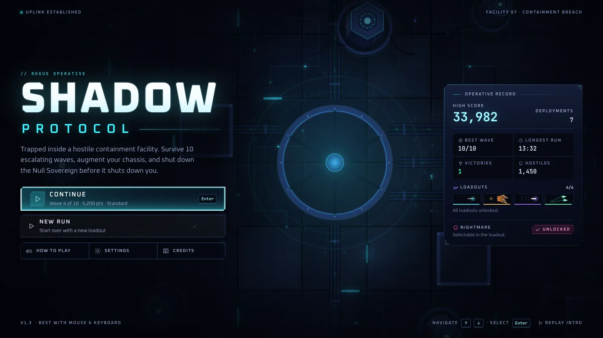

*The main menu runs over the live arena. Continue resumes the last checkpoint; the operative record shows saved stats and unlocks.*

<table>
  <tr>
    <td width="50%">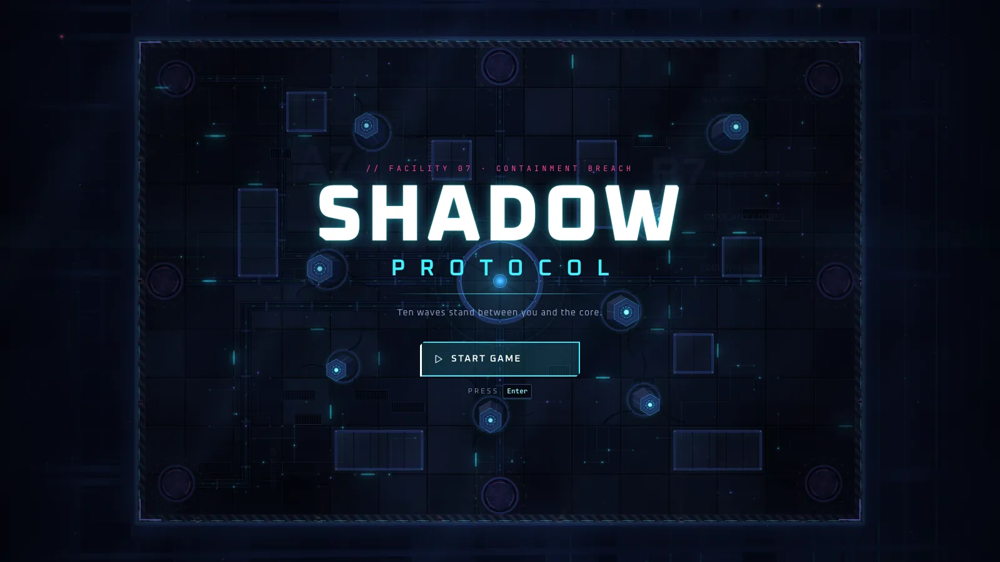</td>
    <td width="50%">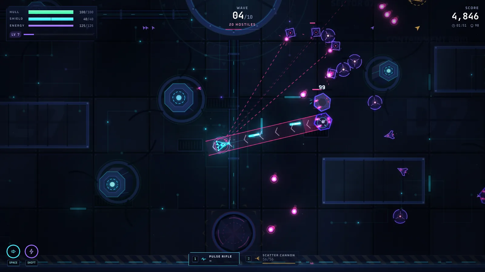</td>
  </tr>
  <tr>
    <td><em>The opening cinematic ends on an establishing shot of the platform.</em></td>
    <td><em>Wave combat with the full HUD: vitals, wave counter, score, dash and boost readiness, and the weapon bar.</em></td>
  </tr>
</table>

### Combat and boss encounters

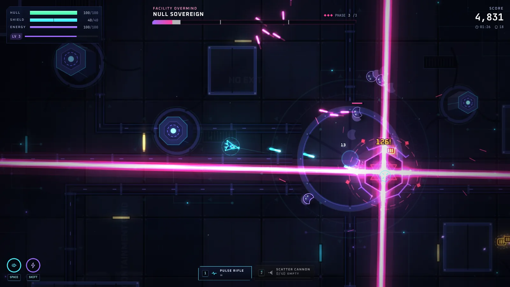

*Null Sovereign, phase 3 of 3: crossed sweeping lasers. The boss bar marks each phase threshold.*

<table>
  <tr>
    <td width="50%">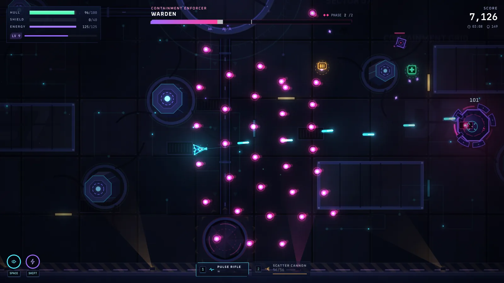</td>
    <td width="50%">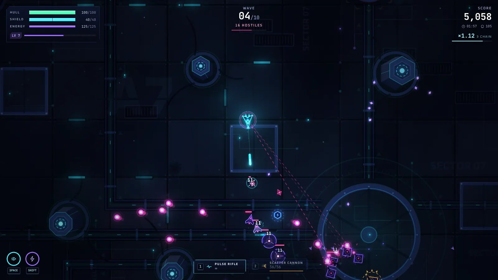</td>
  </tr>
  <tr>
    <td><em>The Warden's second phase: fan volleys with gaps to dodge through.</em></td>
    <td><em>Mixed waves arrive through portals and close in from several sides.</em></td>
  </tr>
</table>

### Progression and upgrades

<table>
  <tr>
    <td width="50%">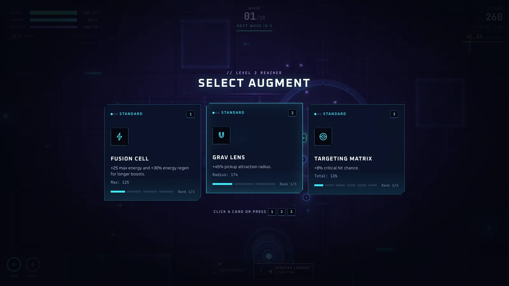</td>
    <td width="50%">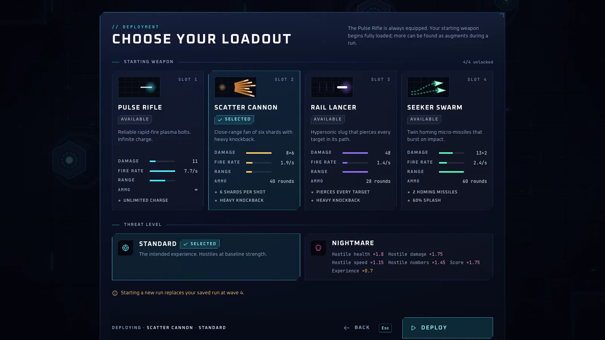</td>
  </tr>
  <tr>
    <td><em>Each level-up pauses the fight and offers three augments, weighted by rarity.</em></td>
    <td><em>Pick a starting weapon and difficulty. Loadouts unlock as you progress.</em></td>
  </tr>
  <tr>
    <td>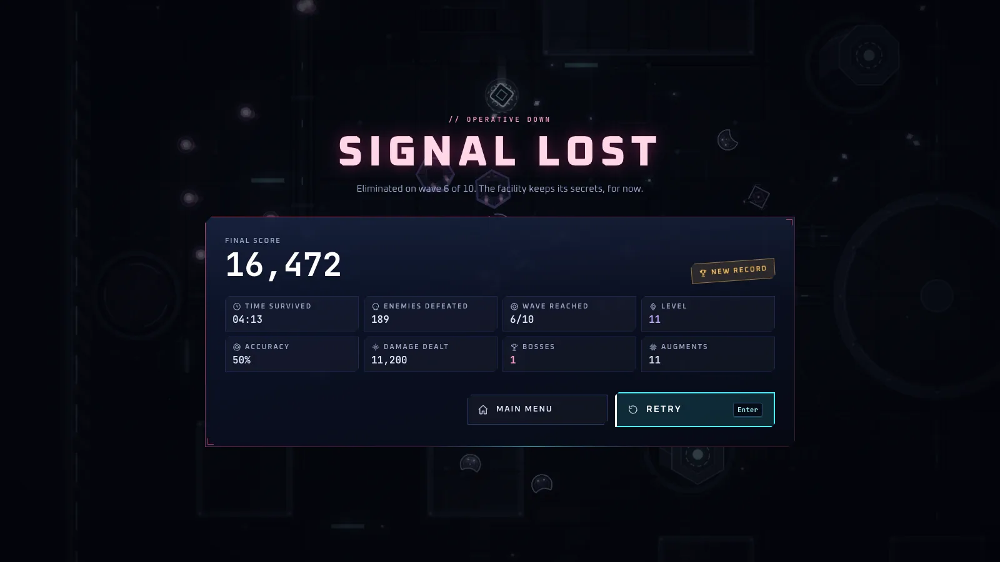</td>
    <td>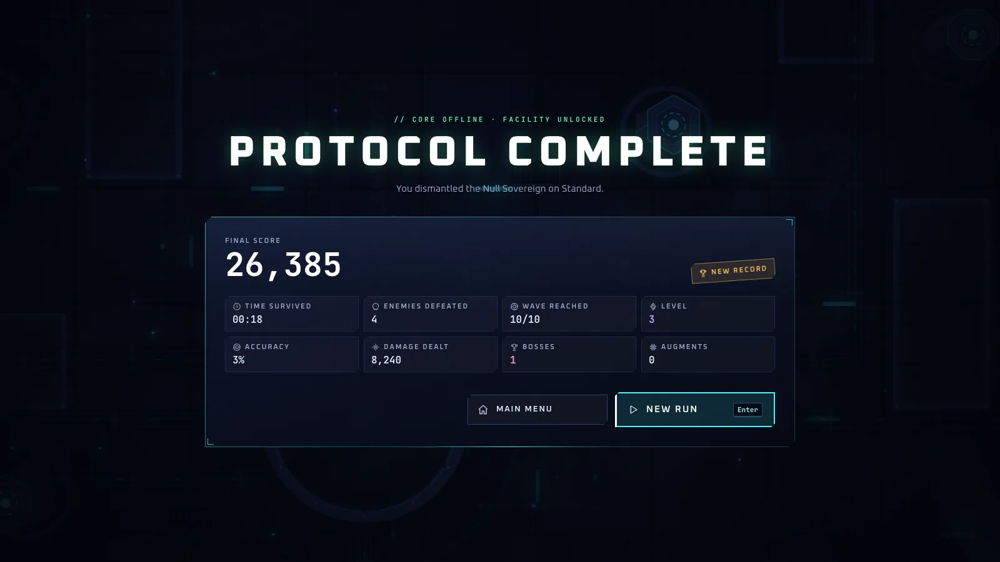</td>
  </tr>
  <tr>
    <td><em>Defeat on wave 6 after beating the Warden, from an unassisted run.</em></td>
    <td><em>Victory after the Null Sovereign falls. This capture skipped ahead with debug mode, hence the short run stats.</em></td>
  </tr>
</table>

### Menus and settings

<table>
  <tr>
    <td width="50%">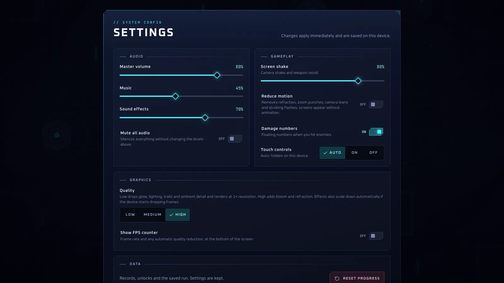</td>
    <td width="50%">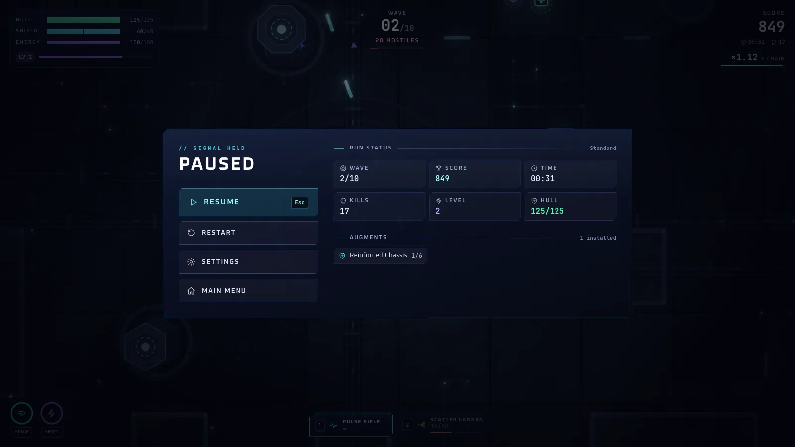</td>
  </tr>
  <tr>
    <td><em>Audio, gameplay comfort and graphics settings apply immediately and are saved on the device.</em></td>
    <td><em>Pausing desaturates the frozen arena. <code>Esc</code> always steps back exactly one level.</em></td>
  </tr>
</table>

### Responsive and mobile

<table>
  <tr>
    <td width="30%">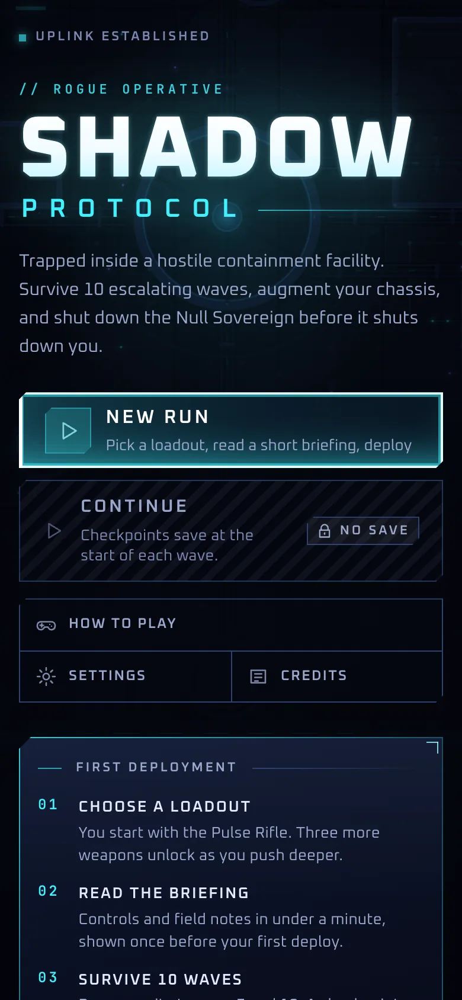</td>
    <td width="30%">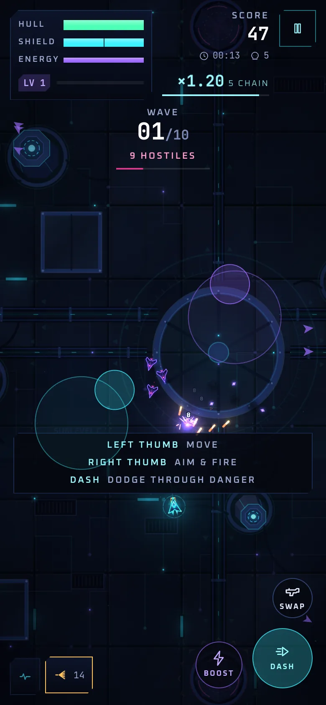</td>
    <td width="40%"><em>On a 390 × 844 phone viewport, the menu stacks into one column and the HUD compacts. Touch play uses two virtual sticks (left half moves, right half aims and fires) plus Dash, Boost and Swap buttons.<br><br>Captured with Chrome's mobile emulation; see <a href="docs/KNOWN_ISSUES.md">known issues</a> for real-device testing status.</em></td>
  </tr>
</table>

## Quick start

### Requirements

- **Node.js 22.13+ or 24** (`.nvmrc` pins 24). Vitest 5 and ESLint 10 don't support Node 20.
- **npm** (bundled with Node). The repository ships a `package-lock.json`.
- A current desktop or mobile browser. Development and automated testing use Chrome.

### Run it

```bash
git clone https://github.com/tanmaytyagii/shadow-protocol.git
cd shadow-protocol
npm ci          # installs exactly what package-lock.json lists
npm run dev     # http://localhost:5173
```

These commands are the same on macOS, Linux and Windows (PowerShell or Command Prompt).

### Build for production

```bash
npm run build     # type-check, then bundle into dist/
npm run preview   # serve dist/ at http://localhost:4173
```

`dist/` is fully static with relative paths, so any static host works, including a sub-directory. See **[deployment](docs/DEPLOYMENT.md)**.

### Troubleshooting

| Problem | Fix |
| --- | --- |
| `npm ci` or `npm test` fails with an engine or syntax error | Check `node -v`; use Node 22.13+ or 24 (`nvm use` reads `.nvmrc`). |
| Port 5173 is already in use | Vite picks the next free port and prints it. Or run `npm run dev -- --port 3000`. |
| No sound | Browsers block audio until the first click, tap or key press. Also check **Settings → Mute**. |
| Low frame rate | Lower **Settings → Graphics quality**. The game also scales effects down automatically. **Show FPS counter** displays the current step. |
| Blank page when opening `dist/index.html` directly | Serve it over HTTP (`npm run preview`); browsers block ES modules from `file://`. |
| Want a clean slate | **Settings → Reset progress**, or clear the site's storage in the browser. |

## Controls

| Action | Keyboard and mouse | Touch |
| --- | --- | --- |
| Move | `W` `A` `S` `D` or arrow keys | Drag on the left half of the screen |
| Aim and fire | Mouse; hold left button | Drag on the right half (fires while aiming) |
| Dash (brief invulnerability) | `Space` | **Dash** |
| Boost (drains energy) | Hold `Shift` | Hold **Boost** |
| Switch weapon | `1`–`4`; `Q` / `E` or wheel for previous / next | **Swap** |
| Pause | `Esc` or `P` | Pause button |
| Pick an augment | Click, or press `1` `2` `3` | Tap a card |

Menus work entirely from the keyboard (`↑` `↓` `←` `→`, `Enter`, `Esc`). The full reference, including the debug hotkeys, is in **[docs/CONTROLS.md](docs/CONTROLS.md)**.

## Architecture

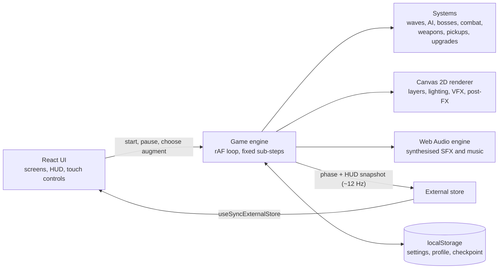

- **The engine is framework-free.** `src/game/` has no React imports. It owns one `requestAnimationFrame` loop with ≤ 1/60 s sub-steps, so movement is frame-rate independent and fast bullets don't tunnel.
- **React never renders per frame.** The UI subscribes to a small store that pushes phase changes immediately and HUD snapshots at about 12 Hz.
- **Presentation is one-way.** The VFX layer reacts to game events but never feeds back into the simulation.
- **Saves are validated.** Every `localStorage` read goes through a sanitiser, so corrupt or old data can't crash the game. Saves from v1.1 still load.

```text
src/
├── game/          Engine: Game loop, Input, Camera, SpatialGrid, persistence
│   ├── systems/   director, waves, enemyAI, boss, combat, weapons, pickups, upgrades
│   ├── entities/  Player, Enemy, Projectile, Pickup, Hazard
│   ├── render/    Renderer, Environment, Lighting, vfx, Effects, PostFX, PerfGovernor
│   └── audio/     AudioEngine (procedural SFX, music, ambience)
└── ui/            React: screens, HUD, touch controls, shared components
scripts/           Browser automation: e2e, screenshots, perf, soak, audio levels
docs/              Guides and technical documentation
```

Read more in **[docs/ARCHITECTURE.md](docs/ARCHITECTURE.md)** (systems, render layers, audio, persistence) and **[docs/INTERFACE.md](docs/INTERFACE.md)** (design system, input rules, responsive layout).

## Testing

| Command | Checks |
| --- | --- |
| `npm run lint` | ESLint with typescript-eslint and React Hooks rules |
| `npm run typecheck` | TypeScript strict mode |
| `npm test` | Vitest unit tests: waves, augments, saves, input, collision, adaptive quality, cinematic and menu framing, design-token contrast |
| `npm run build` | Type-check and production bundle |
| `npm run test:e2e` | Drives the production build in headless Chrome: intro, menus, full runs, bosses, saves and Continue, audio unlock, focus and `Esc` rules, touch layout, and a clean console |

[GitHub Actions](.github/workflows/ci.yml) runs lint, type-check, unit tests and the build on Node 22 and 24, then the end-to-end suite, on every push to `main` and every pull request.

Further scripts cover layout audits across nine viewports, frame pacing, memory soak tests and audio loudness. **[docs/TESTING.md](docs/TESTING.md)** explains each one and records the latest results.

## Roadmap

**Shipped in 1.3:** the full game loop (10 waves, 2 multi-phase bosses, 4 weapons, 21 augments), persistence and Continue, touch controls, the opening cinematic, the responsive full-screen menu, and adaptive quality.

**Next:**

- [ ] Test on real iOS and Android devices, Safari and Firefox
- [ ] A screen-reader pass and a listening pass on the audio mix
- [ ] A public playable build (GitHub Pages; [instructions ready](docs/DEPLOYMENT.md#github-pages))
- [ ] Gamepad support
- [ ] Key remapping
- [ ] A touch control for cycling to the previous weapon

Current limitations are listed in **[docs/KNOWN_ISSUES.md](docs/KNOWN_ISSUES.md)**.

## Contributing

Bug reports, device test results and pull requests are welcome. Start with **[CONTRIBUTING.md](CONTRIBUTING.md)**, follow the **[code of conduct](CODE_OF_CONDUCT.md)**, and report security issues privately as described in **[SECURITY.md](SECURITY.md)**. Changes are tracked in the **[changelog](CHANGELOG.md)**.

## Credits and license

Design and development by **[Tanmay Tyagi](https://github.com/tanmaytyagii)**.

Built with [React](https://react.dev), [TypeScript](https://www.typescriptlang.org), [Vite](https://vite.dev), [Tailwind CSS](https://tailwindcss.com), [Vitest](https://vitest.dev) and [Playwright](https://playwright.dev). The typefaces are [Oxanium](https://fonts.google.com/specimen/Oxanium) and [JetBrains Mono](https://www.jetbrains.com/lp/mono/), both under the SIL Open Font License 1.1, self-hosted through [Fontsource](https://fontsource.org).

**License:** this repository doesn't have a license yet, so all rights are reserved by the author. You're welcome to play it, read the code and open issues or pull requests, but reuse or redistribution needs the author's permission.
