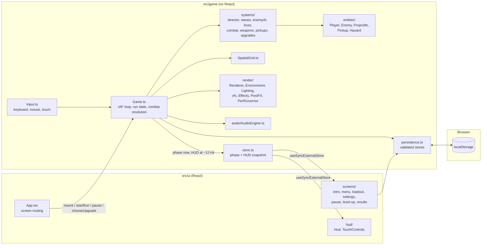

# Architecture

SHADOW PROTOCOL is a single-page app with two halves that meet in one place:

- **`src/game/`**: a framework-free engine (no React imports) that owns the simulation, the Canvas 2D renderer and the Web Audio engine.
- **`src/ui/`**: a React 19 + Tailwind CSS 4 interface (menus, HUD, overlays) that reads the engine's state through an external store and calls its public methods.

There are no image or audio files. Every visual is drawn procedurally and every sound is synthesised at runtime. The only runtime dependencies are React, React DOM and two self-hosted variable fonts.

## Overview



## Entry points

| File | Role |
| --- | --- |
| `index.html` | Page shell and viewport settings. |
| `src/main.tsx` | Loads the fonts and stylesheet, mounts `<App>` inside an error boundary and React StrictMode. |
| `src/App.tsx` | Creates the single `Game` instance, mounts it onto the canvas, unlocks audio on the first gesture, and routes between screens. |
| `src/game/Game.ts` | The engine: lifecycle, the `requestAnimationFrame` loop, run state, combat resolution and the bridge to the UI. |

## Game loop

- `Game` owns one `requestAnimationFrame` loop. Frame time is clamped to 100 ms (so a suspended tab doesn't jump) and split into sub-steps of at most 1/60 s. Movement is frame-rate independent and fast projectiles don't tunnel.
- **Update and render are separate.** `tick()` runs `update()` once per sub-step, then the presentation layer (`vfx`), the camera and the HUD publisher, and finally `renderer.render()` once per frame.
- Hit-stop and slow-motion scale the simulation time on top of that.
- Each phase does only what it needs: `playing` simulates and renders; `levelup` freezes the simulation while effects dissipate; `gameover` and `victory` let final explosions play out; `paused` redraws only when something changes; `idle` runs the menu's attract scene.
- An exception in the loop halts the simulation and shows a recovery screen instead of a frozen canvas. A React error boundary covers the UI.

### One simulation step (`Game.update`)

1. Player movement, dash, boost and firing (`updatePlayer`, `systems/weapons.ts`).
2. Wave director: spawn queue, portals, intermissions, boss arrival (`systems/director.ts`, `systems/waves.ts`).
3. Rebuild the spatial grid with active enemies (`SpatialGrid.ts`).
4. Enemy AI and boss patterns (`systems/enemyAI.ts`, `systems/boss.ts`), then integrate velocities.
5. Enemy separation and player contact resolution.
6. Projectiles, hazards (rings, lasers, mines) and pickups (`systems/combat.ts`, `systems/pickups.ts`).
7. Particles, combo and streak timers.

## Systems

| Module | Responsibility |
| --- | --- |
| `systems/waves.ts` | Wave definitions (enemy mix, elite chance, pacing, boss waves) and spawn-queue construction. Unit-tested. |
| `systems/director.ts` | Runs the current wave: spawn timing, portal choice away from the player, intermissions, wave-clear rewards. |
| `systems/enemyAI.ts` | Per-kind behaviour (swarm, kite, charge, orbit and dodge, split). |
| `systems/boss.ts` | Warden and Null Sovereign phase machines and attack patterns. |
| `systems/combat.ts` | Projectile movement and hits, hazards, lasers and mines. |
| `systems/weapons.ts` | Weapon definitions and firing. |
| `systems/pickups.ts` | Drop tables, magnet pull, power-ups. |
| `systems/upgrades.ts` | The 21 augments, rarity-weighted rolls and stat computation. Unit-tested. |
| `SpatialGrid.ts` | Broad-phase grid for bullet, contact and separation queries. |
| `Camera.ts` | Follow camera, zoom-to-fit and trauma-based screen shake. |

Projectiles are pooled. Enemies are bucketed in the spatial grid each step.

## Rendering

`render/Renderer.ts` draws one frame in a fixed layer order, back to front:

1. The abyss beyond the platform rim, then the parallax reactor sub-level seen through glass panels.
2. The deck, baked once per run into an offscreen canvas (`render/Arena.ts`), then scorch decals.
3. Dynamic floor lighting from projectiles, explosions, lasers, pickups and the player (`render/Lighting.ts`), then animated emissives.
4. Ground hazards and telegraphs, contact shadows, pickups, pseudo-3D reactor pillars.
5. Enemies, corpses, the player, projectiles, particles, lasers and damage numbers (`render/draw/*`).
6. The rim, haze and light shafts (`render/Environment.ts`).
7. Post-processing (`render/PostFX.ts`): shockwave refraction, a thresholded bloom on ¼ and ⅛ resolution copies, colour grade, vignette and damage flashes. Nothing blurs the full screen.

Glow uses cached radial-gradient sprites and additive blending instead of `shadowBlur`.

- **Presentation layer** (`render/vfx.ts`) reacts to game events but never feeds back into the simulation: per-weapon muzzle flashes, projectile signatures and impacts; per-enemy death recipes; shield hit, break, reboot and restore cues; dash ribbons with refraction; level-up and pickup bursts; merged damage numbers.
- **Combat intensity** drives the mood: strip lights flicker amber, rim beacons sweep, the reactor shifts toward violet and the colour grade warms as fights escalate.
- **Boss presentation.** Arrivals use a letterbox, a camera lean and pull-back, a light column and converging arcs; the Warden descends and the Null Sovereign assembles ring by ring. Phase changes have their own effects (the Warden sheds armour plates; the Sovereign adds an overclock ring and turns into a red singularity). Defeat plays a cracking, shuddering corpse and then a final detonation.
- **Adaptive quality** (`render/PerfGovernor.ts`) samples frame pacing. When the device drops frames or can't hold about 50 fps it steps decorative cost down, and steps back up with headroom. It has five levels; the last drops lighting, grading and shadows and renders at 0.6× resolution. It never exceeds the player's preset and never touches gameplay. If the browser reports a software renderer, it starts conservatively. Unit-tested.
- **Menu framing** (`menuFraming.ts`) and the **opening cinematic** (`intro.ts`) are pure, unit-tested functions that drive the camera and lighting over the live arena.

## Audio

`audio/AudioEngine.ts` synthesises every effect, the music sequencer and the reactor ambience with the Web Audio API.

- Nothing plays before the first user gesture (pointer, key or touch).
- Everything runs through a compressor and limiter. Repeated sounds are throttled and voices are capped.
- Each effect has a mix trim (`MIX`) set from offline loudness measurements (`npm run audio:levels`): rare big events loudest, then heavy impacts, weapons and player feedback, cues and stingers, frequent small sounds, and the interface quietest. The levels have been measured, not yet checked by ear.
- **Readable bosses:** each attack family has its own wind-up cue (the Warden's charge, stomp rumble and volley lock-on; a pitched lock-on chirp for each Null Sovereign bullet pattern), separate from laser charge and teleport. Phase changes have their own stinger.
- **Ambience:** a restrained reactor hum (low A, octave, faint fifth and band-passed air) under the opening, the menu and, quietly, combat. It follows the music volume.
- Mute zeroes the master bus, the sliders move it smoothly, and the context is suspended while the tab is hidden.
- If Web Audio is unavailable, the game runs silently.

## State and UI

- **`store.ts`** is a minimal external store. Phase changes are pushed immediately; the HUD snapshot is published at about 12 Hz. React reads it with `useSyncExternalStore`, so React never re-renders per frame.
- **`Game.mount` / `Game.unmount`** are symmetrical and idempotent, so StrictMode's double mount can't start two loops. Listeners, the `ResizeObserver` and the `AudioContext` are released on unmount.
- **Screens** (`ui/screens/`) are built from shared components in `ui/components/` (Button, Toggle, Slider, Segmented, Badge, Stat, Panel, KeyCap, ScreenShell, ScreenHeader, ActionBar, WeaponEmblem, Icon). The design system is described in [INTERFACE.md](INTERFACE.md).

## Persistence

`persistence.ts` keeps three `localStorage` keys, each behind a validating sanitiser so corrupt or old data never crashes the game:

| Key | Contents |
| --- | --- |
| `shadow-protocol:settings:v1` | Volumes, mute, screen shake, reduce motion, damage numbers, graphics quality, FPS counter, touch-control mode |
| `shadow-protocol:profile:v1` | Records, unlocks, last loadout, and the briefing and intro flags |
| `shadow-protocol:run:v1` | The checkpoint used by **Continue** (written at the start of waves 2 and later) |

If storage is full or blocked (for example in some private-browsing modes), the game still runs; progress just isn't kept.

## Directory layout

```text
.
├── .github/                 CI workflow, issue and pull request templates
├── docs/                    Guides, architecture, testing, deployment, screenshots
├── public/favicon.svg
├── scripts/                 Browser automation (Playwright Core + local Chrome)
│   ├── e2e.mjs              End-to-end suite
│   ├── screens.mjs          Screenshot matrix with a layout audit
│   ├── landing-qa.mjs       Main menu at ten viewports and three player states
│   ├── perf.mjs             Frame cost and pacing probe
│   ├── soak.mjs             Repeated cycles; checks nothing accumulates
│   ├── balance.mjs          Bot simulation for difficulty tuning
│   ├── audio-levels.mjs     Offline loudness report
│   ├── readme-shots.mjs     Captures the README screenshots
│   └── optimize-screenshots.mjs
├── src/
│   ├── main.tsx · App.tsx · ErrorBoundary.tsx · index.css
│   ├── game/
│   │   ├── Game.ts · Input.ts · Camera.ts · SpatialGrid.ts · store.ts
│   │   ├── persistence.ts · constants.ts · types.ts · math.ts
│   │   ├── intro.ts · menuFraming.ts
│   │   ├── audio/AudioEngine.ts
│   │   ├── entities/        Player, Enemy, Projectile, Pickup, Hazard
│   │   ├── systems/         director, waves, enemyAI, boss, combat, weapons, pickups, upgrades
│   │   └── render/          Renderer, Arena, Environment, Lighting, Effects, vfx, PostFX,
│   │                        PerfGovernor, sprites, frame, draw/*
│   └── ui/
│       ├── components/      controls, layout, Icon, WeaponEmblem
│       ├── hud/             Hud, TouchControls
│       ├── screens/         IntroSequence, MainMenu, Loadout, Tutorial, SettingsScreen,
│       │                    Credits, PauseMenu, LevelUp, Results
│       └── context.ts · input.ts · upgradeText.ts
├── CHANGELOG.md · CONTRIBUTING.md · SECURITY.md · CODE_OF_CONDUCT.md
└── package.json · vite.config.ts · eslint.config.js · tsconfig*.json
```

Unit tests (`*.test.ts`) sit next to the code they cover.

## Build

Vite 8 with the React and Tailwind plugins. `npm run build` type-checks with `tsc -b`, then bundles to `dist/` with relative asset paths (`base: './'`), so the output can be served from any static host or sub-directory. See [DEPLOYMENT.md](DEPLOYMENT.md).
